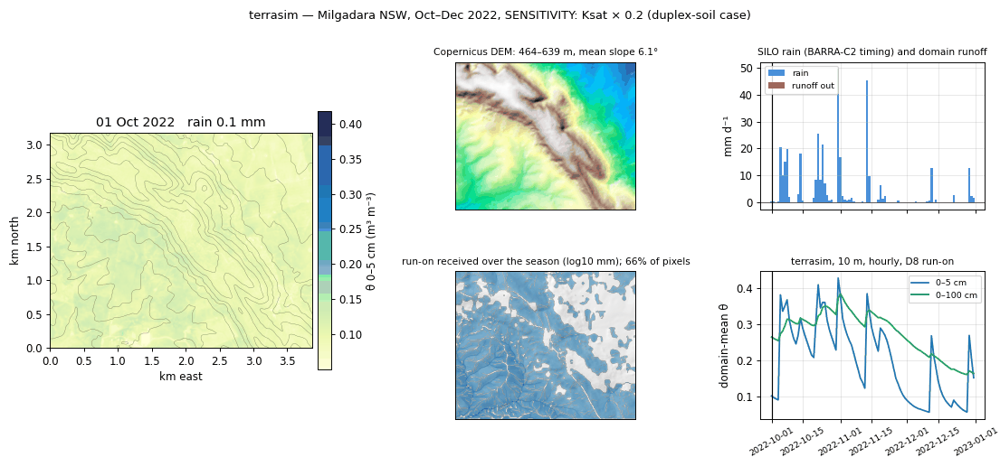

# terrasim

**Process-based soil moisture for Australian paddocks at 10 m, hour by hour,
built to feed DAESIM.** terrasim runs a layered soil-water balance on the
Sentinel-2 10 m grid: Green-Ampt infiltration driven by sub-daily rain,
Campbell drainage, FAO-56 dual-crop evapotranspiration steered by NDVI, and
downslope run-on routing from the DEM. Soil hydraulics come from the Soil and
Landscape Grid of Australia (porosity from bulk density, conductivity by
pedotransfer), daily climate from SILO, within-day rain timing from the
BARRA-C2 reanalysis. Part of the
[Borevitz Lab](https://biology.anu.edu.au/research/research-groups/borevitz-group-plant-genomics-climate-adaption)
ecosystem (`troi`, `pysilo`, `pyslga`, `pycopdem`, `pysentinel2`, `pyozwald`).

```
inputs (cached stores)                 terrasim                          outputs
SILO daily  ─┐                  ┌─ forcing: rain (SILO total × BARRA   ┌─ run.zarr (time, layer, y, x)
BARRA-C2 1h ─┼─ ForcingBuilder ─┤   hourly weights), ET0 diurnal, Kcb │   theta, fluxes, mass residual
Sentinel-2  ─┘                  └───────────────┐                      ├─ daily domain-mean CSV
SLGA 90 m   ─┐                  ┌─ static: theta_s, DUL, L15, K_sat,  ├─ DAESIM forcing CSV
Copernicus  ─┼─ StaticBuilder ──┤   b, psi_e, roots, D8 levels, TWI   └─ DAESIM SoilLayers JSON
DEM 30 m    ─┘                  └───────────────┴─► Engine.step() per hour, every pixel
```



*Milgadara NSW (the lab site, 175 m of relief), Oct–Dec 2022, with `SoilParams(ksat_multiplier=0.2)`: 0–5 cm moisture on the 10 m grid, the DEM, run-on received over the season concentrating in the drainage lines, SILO rain with BARRA-C2 timing, and domain-mean moisture.*

## Install

```bash
conda env update -n troi -f environment.yml      # shared lab env; never --prune
conda activate troi
pip install -e ../troi && pip install -e .
```

Credentials (free): a SILO registration email and a TERN API key for SLGA, in
`~/.config/Troi.json` (`"email"`, `"tern_api_key"`) or `TROI_EMAIL` / `TROI_TERN_KEY`.
BARRA-C2, the Copernicus DEM and Sentinel-2 need none.

## Usage

```python
from datetime import date
from troi import Troi
from terrasim.model import Model

troi = Troi(bbox=[148.36265, -33.52606, 148.38265, -33.50606],   # [W, S, E, N]
            start=date(2022, 1, 1), end=date(2022, 12, 31), stub='grenfell')
ds = Model().run(troi)                       # -> xr.Dataset, also written to {out_dir}/grenfell/terrasim/run.zarr
ds['theta'].isel(layer=0).mean(('y', 'x')).plot()
```

Tune the run with `Terrasim(step='20min', routing='twi', ...)`, physical constants
with `Params(soil=SoilParams(ksat_multiplier=2.0))`, and the layer geometry with
`LayerSpec` (DAESIM-compatible: `fixed`, `scaled_exp`, `horizon`).

Command line:

```bash
terrasim run --bbox 148.36265 -33.52606 148.38265 -33.50606 --start 2022-01-01 --end 2022-12-31 --stub grenfell
terrasim export-daesim --stub grenfell                   # area-mean forcing CSV + soil params JSON
terrasim export-daesim --stub grenfell --paddocks paddocks.gpkg --label paddock
terrasim validate --stub grenfell --oznet Y5.xls --pixel -34.72 146.29
```

## What it does, briefly

| Piece | Choice | Notes |
|---|---|---|
| Grid | pysentinel2's 10 m EPSG:6933 | pixel-aligned with NDVI and paddock rasters |
| Layers | 6 horizons to 2 m (5/10/15/30/40/100 cm) | any DAESIM `SoilLayers` spec works |
| Rain | SILO daily total, BARRA-C2 hourly timing | SILO's 09:00–09:00 day honoured; fallback to climatological/uniform timing; `step='20min', within_hour='peaked'` puts 60% of each hour into one sub-step so bursts can exceed K_sat |
| Infiltration | Green-Ampt (time compression) + fill-and-spill | event reset after 6 dry hours |
| Drainage | Campbell K(θ), limited, sub-stepped | `0 ≤ θ ≤ θ_s` guaranteed |
| ET | FAO-56 dual crop; Kcb from NDVI | external per-layer uptake hook for DAESIM |
| Routing | D8 run-on with re-infiltration | `twi` and `none` alternatives |
| Mass balance | checked every step, every pixel | reported as `residual` |

Full equations: [docs/physics.md](docs/physics.md). Forcing rules:
[docs/forcing.md](docs/forcing.md). DAESIM mapping: [docs/daesim.md](docs/daesim.md).

## Tests

```bash
pytest -m "not network"      # offline suite (synthetic soils, DEM, climate)
pytest -m network            # live checks: BARRA-C2, SILO, SLGA
```

## Layout

```
terrasim/
  terrasim.py   run settings        params.py      physical parameters      layers.py   DAESIM-compatible layers
  grid.py       10 m model grid     pedotransfer.py SLGA -> hydraulics      terrain.py  D8 geometry on 10 m
  static.py     terrain+soil zarr   barra.py       BARRA-C2 hourly store    disaggregate.py SILO -> sub-daily
  vegetation.py NDVI -> Kcb, fc     forcing.py     Forcing assembly         physics/    campbell, infiltration, drainage,
  model.py      run + zarr output   export.py      DAESIM CSV/JSON                      evapotranspiration, routing, engine
  validate.py   OzNet / OzWALD      cli.py         terrasim run|static|export-daesim|validate
```

MIT licence.
